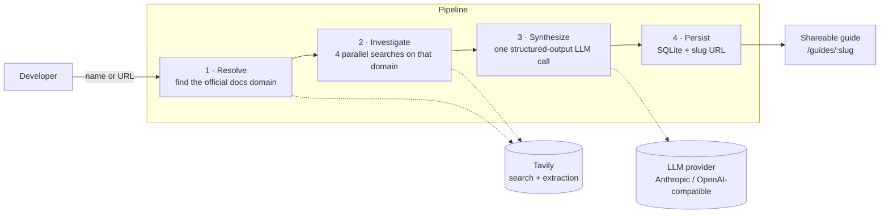

# OAuth App Setup Guide Agent

> Look up any app and get a shareable, evidence-backed guide to registering its OAuth app and getting it approved, so your users can connect it to your AI agent.

**Live demo:** https://oauth-guide-agent.onrender.com

---

## Contents

- [The problem](#the-problem)
- [What it does](#what-it-does)
- [Try it](#try-it)
- [Quick start](#quick-start)
- [Configuration](#configuration)
- [Architecture](#architecture)
- [API](#api)
- [Project structure](#project-structure)
- [Key decisions](#key-decisions)
- [Evaluation: checking the guides against real sources](#evaluation-checking-the-guides-against-real-sources)
- [Limitations](#limitations)
- [Deployment](#deployment)

## The problem

Before a developer's users can connect a third-party app to their agent, the developer usually has to register an **OAuth app** with that provider. That gives them the client ID and secret, redirect URIs and scopes that every user connection runs through. Many providers also put that app through review before **external** users (people outside the developer's own account or organization) can authorize it.

Developers today piece this together from scattered docs, unfamiliar consoles and emails to the provider. The hard part is not knowing up front whether setup will take fifteen minutes or six weeks, or what will get the app rejected.

## What it does

A developer looks up an app, either from the library or by typing any name or website, and gets a guide that answers:

| Question | Where it appears in the guide |
|---|---|
| How hard is this? | **Difficulty**: `trivial`, `moderate` or `hard`, graded on whether a manual gate stands between the developer and external users |
| How long will it take? | **Active time** (hands-on work), shown separately from **waiting on the provider** (review queues) |
| What do I do, in what order? | **Steps**, each tagged *agent can help* or *you* |
| What can trip me up? | **Gotchas**, **approval process** and **rejection risks** |
| What do I do when I'm stuck? | **If you get stuck**: blockers paired with what to do about them |
| What can an agent do for me? | **What an agent can do** vs. **what you must do** |
| How much can I trust this? | **Evidence**: each claim is *supported by the docs*, *inferred* or *couldn't be determined*, with every source page listed |

Apps outside the library are **investigated live**. An agent finds the provider's official developer docs, reads the pages on app registration, scopes, review and limits, and drafts the guide while the page streams its progress. Every guide gets a stable, shareable URL: `/guides/<slug>`.

Guides are labelled by provenance:
- **Verified against live docs**: seed guides checked claim by claim against the provider's current official documentation.
- **Agent-generated · not reviewed**: guides produced live by the agent.

### Difficulty bands

| Band | Meaning |
|---|---|
| `trivial` | Self-serve app creation. No manual review before external users can connect. |
| `moderate` | Self-serve, with real nuances: user caps in development mode, distribution toggles, scope tiers, a sandbox/production split, or optional marketplace review. |
| `hard` | A mandatory review, verification, security assessment or partner approval before external users can connect, with a meaningful wait. |

## Try it

The library includes 10 checked guides that span the bands:

| Band | Apps |
|---|---|
| Trivial | Todoist, Discord |
| Moderate | GitHub, Slack, Notion, Atlassian (Jira / Confluence), Dropbox, LinkedIn |
| Hard | Gmail, Spotify |

To see live generation, enter an app that isn't in the library, such as `Zoom`, `Asana`, `https://calendly.com` or `HubSpot`. A generation takes about 30–90 seconds. Entering a website URL instead of a name helps when the name is ambiguous.

## Quick start

**Prerequisites:** Node.js 22 or later, an LLM API key (Anthropic by default), and optionally a [Tavily](https://tavily.com) API key (the free tier is enough).

```bash
git clone https://github.com/code-infected/oauth-guide-agent.git
cd oauth-guide-agent
npm install
cp .env.example .env        # add your keys
npm run dev                 # http://localhost:3000
```

For a production build:

```bash
npm run build
npm start
```

### Scripts

| Command | Description |
|---|---|
| `npm run dev` | Start the server with auto-reload (tsx) |
| `npm run build` | Compile TypeScript to `dist/` |
| `npm start` | Run the compiled server |
| `npm run seed:drafts [-- app ...]` | Run seed apps through the pipeline and write drafts to `src/seed/drafts/` |

## Configuration

All configuration is through environment variables (see [`.env.example`](.env.example)).

| Variable | Required | Default | Description |
|---|---|---|---|
| `LLM_PROVIDER` | No | `anthropic` | `anthropic`, or `openai` for OpenAI and any OpenAI-compatible API (OpenRouter, Groq, Together, Ollama, …) |
| `LLM_MODEL` | For `openai` | `claude-opus-5-5` | Model ID |
| `LLM_API_KEY` | Yes¹ | | API key for the selected provider |
| `LLM_BASE_URL` | No | | Custom endpoint for OpenAI-compatible providers |
| `ANTHROPIC_API_KEY` / `OPENAI_API_KEY` | | | ¹ Used if `LLM_API_KEY` is not set |
| `TAVILY_API_KEY` | No | | Without a key, Tavily's keyless mode is used (lower rate limit) |
| `PORT` | No | `3000` | HTTP port |
| `DATABASE_PATH` | No | `./data/guides.db` | SQLite file location |

## Architecture

A single Express + TypeScript service serves the static frontend and the JSON/SSE API. The same four-stage pipeline builds the seed guides and the live guides.



| Stage | What happens | Code |
|---|---|---|
| **Resolve** | Searches for the provider's developer docs and picks the provider's own domain. It ignores third-party blogs and integration platforms. A `developers.` / `docs.` / `api.` host on another domain is accepted only if its pages mention the app (so Gmail resolves to `google.com`). It retries with a second query phrasing, and fails explicitly if nothing plausible is found. | [`resolver.ts`](src/services/resolver.ts) |
| **Investigate** | Runs four parallel searches restricted to the resolved domain: app registration, scopes, review/verification, and rate limits/sandbox vs. production. It keeps at most 10 pages of up to 3,500 characters each. | [`investigator.ts`](src/services/investigator.ts) |
| **Synthesize** | One LLM call with a strict output schema. The model must separate *verified*, *inferred* and *unverifiable* claims, must not state wait times or approval requirements it didn't see, and must set `enoughInformation: false` instead of inventing a guide. | [`synthesizer.ts`](src/services/synthesizer.ts) |
| **Persist** | Saves the guide to SQLite under a unique slug. Sources are attached by the code from the pages actually read, never by the model. | [`store.ts`](src/services/store.ts) |

The output schema is defined once in Zod ([`src/types/guide.ts`](src/types/guide.ts)). It is used both to constrain the LLM output and to validate the result.

## API

| Method & path | Description |
|---|---|
| `GET /api/guides` | List all guides: `slug`, `name`, `difficulty`, `isLive` |
| `GET /api/guides/:slug` | Full guide, or `404` |
| `POST /api/generate` | Body `{ "input": "<app name or URL>" }`. Runs the pipeline and returns the guide. |

`POST /api/generate` responds in one of two ways:
- **JSON** (default): `200` with the guide; `422` when there isn't enough information to build a trustworthy guide; `400` for invalid input; `500` for unexpected errors.
- **Server-Sent Events** (with `Accept: text/event-stream`): `status` events as each stage progresses, then a final `guide` or `error` event.

```bash
curl -N -X POST http://localhost:3000/api/generate \
  -H 'content-type: application/json' -H 'accept: text/event-stream' \
  -d '{"input":"Zoom"}'
```

## Project structure

```
src/
├── app.ts                  Express wiring and static/guide routes
├── server.ts               Entry point; loads seed guides on startup
├── routes/
│   ├── guides.ts           GET /api/guides, GET /api/guides/:slug
│   └── generate.ts         POST /api/generate (JSON or SSE)
├── services/
│   ├── pipeline.ts         resolve → investigate → synthesize
│   ├── resolver.ts         Docs-domain resolution
│   ├── investigator.ts     Targeted searches and page extraction
│   ├── synthesizer.ts      Prompt and structured LLM call
│   ├── llm.ts              Provider-neutral LLM interface + adapters
│   ├── tavily.ts           Tavily search client
│   └── store.ts            SQLite persistence
├── types/guide.ts          Guide schema (Zod) and types
└── seed/
    ├── seed-apps.json      Seed app list
    ├── generate-drafts.ts  Seed draft generator
    └── seed-guides/        Checked seed guides (committed, loaded at startup)
public/                     Library, submit form and guide pages
```

## Key decisions

**Scope: a working live pipeline plus a small checked library, not 100 guides.**
A developer's real question is "what am I in for with *this* app?". Live generation answers it for any app, so it is the core of the product. The 10 seed guides cover all three difficulty bands, and checking them showed how far the pipeline can be trusted (see [Evaluation](#evaluation-checking-the-guides-against-real-sources)).

**"Ready" means external users can connect.**
Many providers let you authorize your own account immediately but put external users behind review, verification or user caps. That gate is what decides whether launch is days or weeks away, so difficulty is graded on it, and active time is reported separately from waiting time.

**Evidence is part of the product, not a footnote.**
Every claim is classified as verified, inferred or unverifiable, and the Evidence section sits on the guide page itself. The model only sees text retrieved from the provider's own domain, and the source list is built by the code, so URLs can't be invented.

**Refuse rather than guess.**
The pipeline stops with a clear "couldn't find enough to go on" in three cases: no official docs domain is found, too little text is retrieved, or the model judges the text insufficient. A confident-sounding fabrication is worse than no guide.

**Not locked to one LLM provider.**
The pipeline depends only on a `generateStructured(schema)` interface. The Anthropic adapter uses native structured outputs, and the OpenAI adapter covers any OpenAI-compatible endpoint. You switch between them with environment variables, with no code changes.

**Tavily for research.**
One call returns both search results and extracted page text, so there is no scraping or HTML-parsing layer to maintain. Restricting each search to the provider's domain keeps third-party content out of the evidence.

**Express on a single Render service, not serverless.**
A generation runs for 30–90 seconds and streams progress. A persistent process avoids function timeouts, and serving the frontend and API from one origin avoids CORS.

**Seed apps chosen to span the bands.**
Candidates came from the [Composio managed-auth directory](https://docs.composio.dev/toolkits/managed-auth). The band each app landed in came from the pipeline, and the documentation check then confirmed or corrected it.

## Evaluation: checking the guides against real sources

Every seed guide was produced by the same pipeline that serves live requests. It was then checked claim by claim against the provider's **current official documentation** (2026-10-20). Each guide's **Evidence → Review against the live docs** section records what was confirmed, what was corrected and what couldn't be verified, with URLs.

| App | Band (draft → checked) | Most significant corrections |
|---|---|---|
| Todoist | trivial → trivial | The draft said tokens don't expire. In fact new apps get 1-hour access tokens with rotating refresh tokens, and reusing a spent refresh token revokes all of that user's tokens. `state` is required. Listing certification is optional. |
| Discord | **moderate → trivial** | Standard user scopes (`identify`, `email`, `guilds`, …) need no review. Bot verification (100+ servers) and Privileged Intent review apply only to bots. `messages.read` was wrongly listed as restricted. |
| GitHub | moderate → moderate | The redirect-URL subdirectory rule only applies when wildcard matching is on. Added PKCE (S256 only), 8-hour token expiry, the 5,000 requests/hour per-user limit and the 10-token cap. Replaced repo-file sources with docs.github.com. |
| Slack | moderate → moderate | Marketplace review is up to 10 business days plus up to 10 weeks (the draft said "a few weeks"). The app must be on 10 or more active workspaces before you can submit. Added the AI-specific rules. Removed a legacy claim that localhost redirects work. |
| Notion | moderate → moderate | Confirmed that public connections need no review (Marketplace listing is optional, 5–10 business days). Corrected the page-sharing flow. Removed guessed form fields. |
| Spotify | hard → hard | The wait is "up to six weeks" per the docs (the draft said "unknown"). Since May 2025 Extended Quota requires an organization with at least 250k MAU. Development Mode is capped at 5 users. Removed an invented revenue requirement. |
| Atlassian | moderate → moderate | Added the required `audience`/`prompt` parameters, the personal-data reporting duty and the "unreviewed app" consent warning. Replaced Bitbucket rate limits with Jira's. |
| Dropbox | moderate → moderate | Production review only starts after 50 linked users (the draft said to apply "well before 50"). Removed Dropbox Sign, a different product. |
| Gmail | hard → hard | `gmail.metadata` is **restricted** (the draft offered it as the easier option). CASA is required for restricted scopes. Filled in the documented waits: brand verification 2–3 days, sensitive scopes 3–5 days, restricted scopes "several weeks". |
| LinkedIn | moderate → moderate | `approval.required` was wrong: Sign In with LinkedIn (OIDC) and Share on LinkedIn are self-serve. The Marketing, Sales and Talent APIs are gated. |

### What the evaluation showed

- **Difficulty bands are reliable.** One of 10 changed. Discord moved down because the draft applied bot-only requirements to every OAuth app.
- **Wait times err on the side of caution.** When the draft was wrong, it usually said "unknown" where the docs did give a figure, rather than inventing one. The one exception understated Slack's review.
- **Most errors came from the wrong pages, not invention.** Pages about sibling products on the same domain (Dropbox Sign, Google Nest, Bitbucket) and legacy pages caused most corrections. The synthesis prompt now tells the model to ignore them.
- **Hallucinations were rare but material.** Two examples are offering a restricted Gmail scope as the easy option and wrongly flagging LinkedIn as approval-gated. A reader can't catch these, which is why live guides carry an *unreviewed* label and a per-claim evidence breakdown.
- **Some requirements live on pages the four searches don't reach**, such as Slack's 10-workspace rule and Atlassian's personal-data reporting. Gap-driven follow-up searches are the clearest next improvement.

## Limitations

- **Verification method.** The seed guides were checked by AI agents (Claude Code) that read each provider's live official documentation. No setup was attempted in a real provider console, and no app was submitted for approval, since both require provider accounts.
- **Live guides are unreviewed.** Their quality depends on what search surfaces from the provider's domain. Requirements documented on another domain, or only on pages the searches don't reach, can be missed.
- **Docs resolution is heuristic.** Ambiguous names (e.g. "Box", "Linear") can resolve to the wrong provider. Entering the website URL avoids this.
- **Storage is ephemeral.** SQLite lives on the instance's disk, so live-generated guides, and their links, are lost on redeploy. Seed guides are committed JSON and reload on every start.
- **Cold starts.** On Render's free tier the service sleeps when idle, and the first request afterwards takes 30–50 seconds.
- **No rate limiting or authentication.** Each live guide costs about 5 Tavily searches and one LLM call. This is acceptable for a demo but not for a public deployment.

## Deployment

The app deploys as a single [Render](https://render.com) Web Service:

| Setting | Value |
|---|---|
| Runtime | Node |
| Build command | `npm install && npm run build` |
| Start command | `npm start` |
| Environment | `ANTHROPIC_API_KEY` (or `LLM_*`), `TAVILY_API_KEY` |

Credentials are only ever set as environment variables. `.env` is git-ignored.
